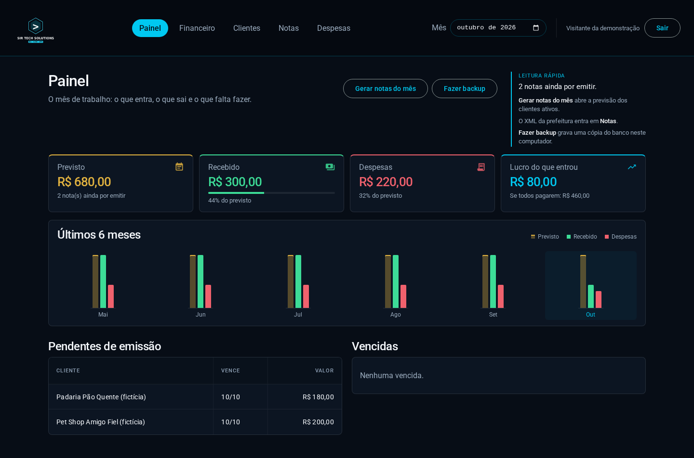
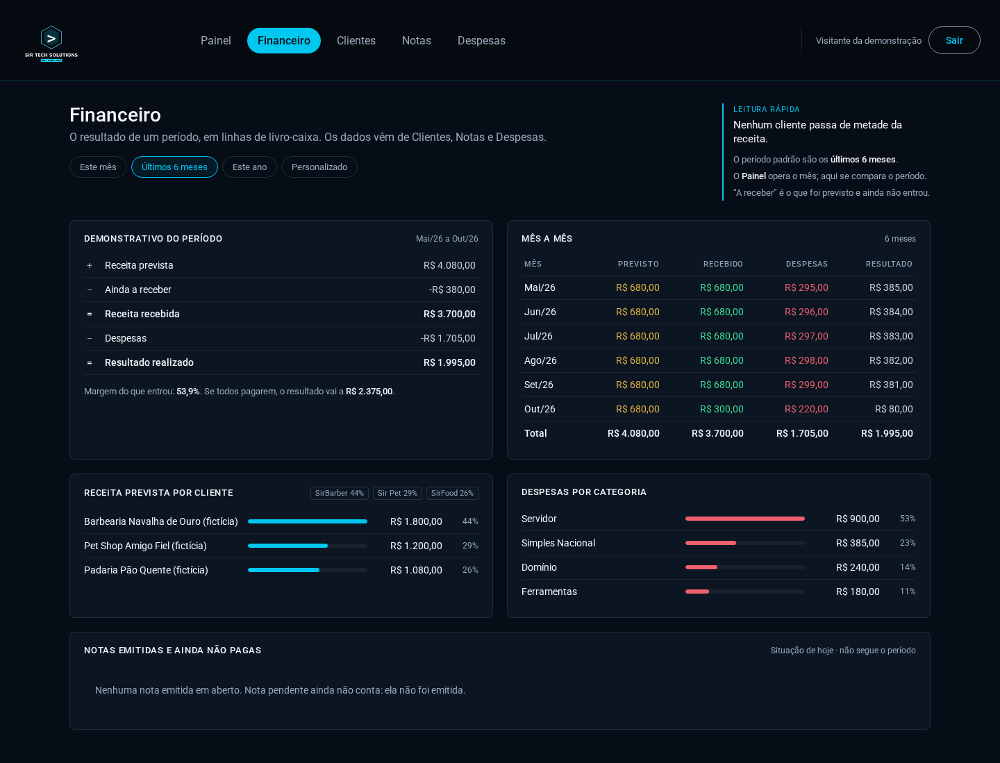
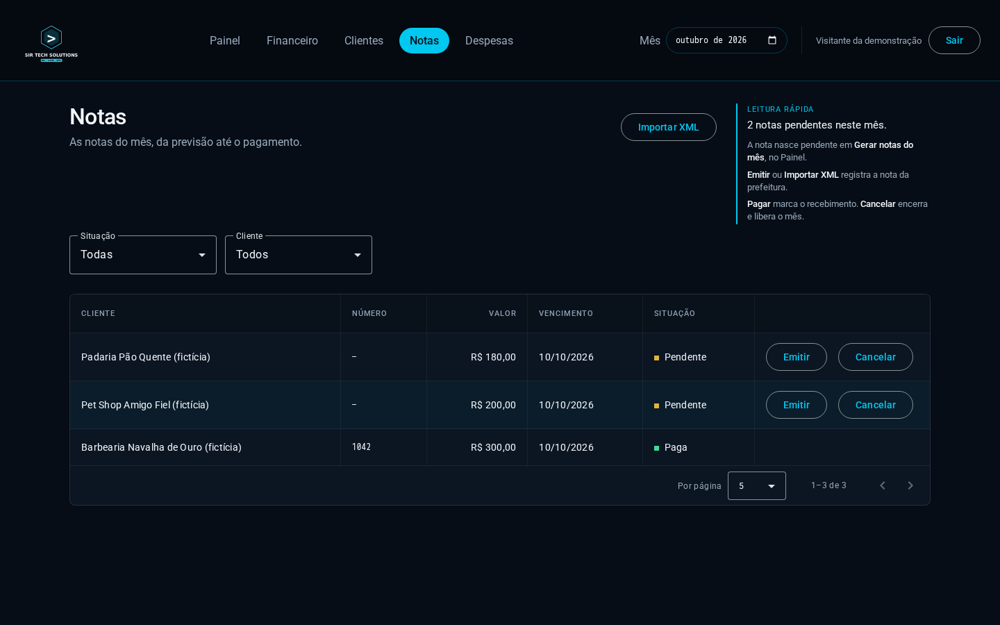
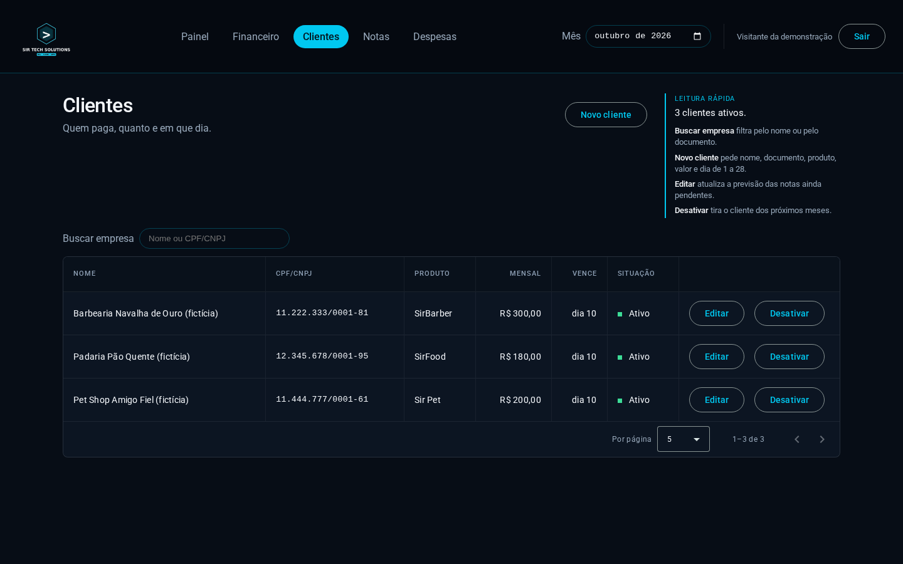
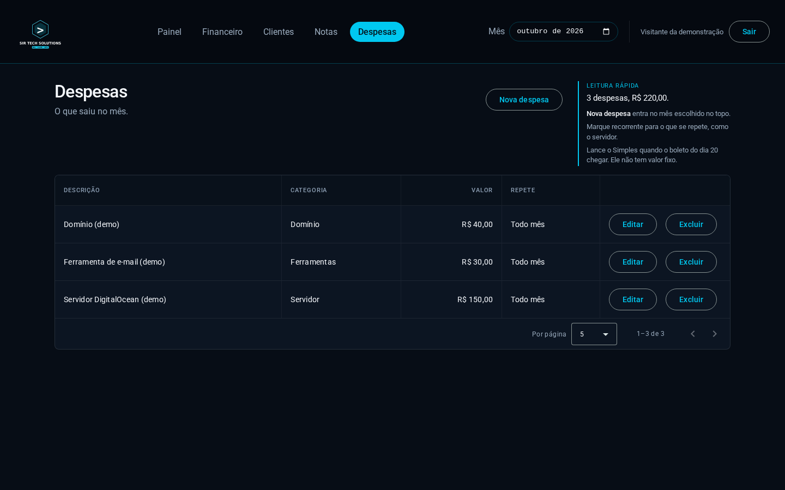
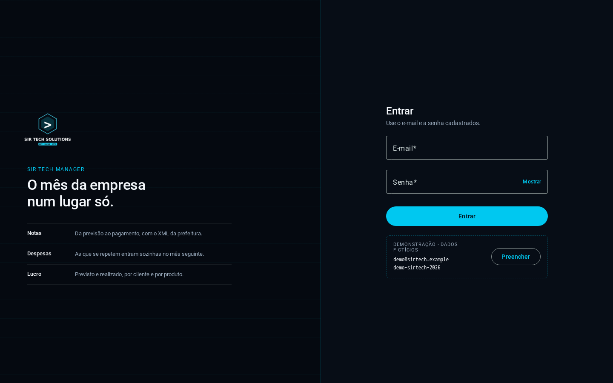

# SirTech Manager

[](https://github.com/sir-devtech/SirTech-Manager/actions/workflows/ci.yml)


Controle mensal de uma empresa pequena de software: clientes, notas fiscais, despesas e o resumo do mês. A nota é emitida no site da prefeitura; o sistema importa o XML. Roda local, num comando.

Feito como sistema real de uso próprio e como estudo de Java. Os dados desta versão são fictícios.


## In English (30 seconds)

**SirTech Manager** is an internal tool I built for my own small software company. It tracks clients, monthly invoices, expenses and profit. Invoices are issued on the city's website, and the app imports the XML, so nothing is typed twice.

- **Stack:** Java 21, Spring Boot 4.1, PostgreSQL 18 with Flyway, Angular 22, Docker Compose.
- **Worth a look:** invoice status rules live in the domain entity; idempotency is enforced by the database (partial unique index + `ON CONFLICT`); session login with BCrypt and CSRF protection.
- **Quality:** 110 API tests on a real PostgreSQL (Testcontainers, 90.5% line coverage, minimum enforced in the build), 114 UI tests, 5 browser end-to-end scenarios with Playwright, and a CI that also scans dependencies for known vulnerabilities.
- **Run it:** `docker compose up -d --build`, open <http://localhost:4200>, and use the demo login shown on the sign-in screen. All data is fictional.

The documentation is in Portuguese. Every architectural decision has a short record in [`docs/adr`](docs/adr).

## Telas

<table>
  <tr>
    <td><br><sub><b>Painel</b>: previsto, recebido, despesas e lucro, com a cor dizendo o que cada número é.</sub></td>
    <td><br><sub><b>Financeiro</b>: o período como livro-caixa, mês a mês, por cliente e por despesa.</sub></td>
  </tr>
  <tr>
    <td><br><sub><b>Notas</b>: pendente, emitida, paga ou cancelada. Os botões seguem a situação.</sub></td>
    <td><br><sub><b>Clientes</b>: cadastro com validação de CPF/CNPJ e busca por empresa.</sub></td>
  </tr>
  <tr>
    <td><br><sub><b>Despesas</b>: avulsas ou recorrentes; a recorrente não precisa ser lançada de novo.</sub></td>
    <td><br><sub><b>Entrar</b>: sem sessão, nenhuma página abre e a API responde 401.</sub></td>
  </tr>
</table>

## Stack

- Java 21, Spring Boot 4.1, Maven Wrapper
- PostgreSQL 18, Flyway
- Angular 22 com Angular Material
- Docker Compose, GitHub Actions
- Spring Security: login com sessão, senha em BCrypt e proteção CSRF
- Testes com JUnit 5, Mockito, Testcontainers, Vitest e Playwright; cobertura medida com JaCoCo; OSV-Scanner e `npm audit` no CI

## Como rodar

Com o Docker ligado:

```bash
docker compose up -d --build
```

Abra `http://localhost:4200` e entre com o login de demonstração, que a própria tela mostra:

| E-mail | Senha |
|---|---|
| `demo@sirtech.example` | `demo-sirtech-2026` |

A API fica em `http://localhost:8080` e o Swagger em `http://localhost:8080/swagger-ui.html` (a leitura é aberta; os pedidos exigem login). A demonstração tem três clientes fictícios e seis meses de histórico.

### Uso real, separado da demonstração

O uso real fica em outro arquivo, com outro banco e sem dados de exemplo. Copie `.env.example` para `.env`, preencha `REAL_POSTGRES_PASSWORD`, `SIRTECH_ADMIN_EMAIL` e `SIRTECH_ADMIN_SENHA`, pare a demonstração e rode:

```bash
docker compose down
docker compose -f docker-compose.real.yml up -d --build
```

Sem essas variáveis o comando nem começa. As portas 4200, 8080 e 5432 atendem só este computador (`127.0.0.1`).

## O que o sistema faz

- **Notas.** A nota nasce pendente, passa a emitida (na mão ou importando o XML da prefeitura) e a paga. Cancelar libera o mês para outra.
- **Geração do mês.** No dia 1, ou ao abrir o sistema, cria a nota pendente de cada cliente ativo e copia as despesas recorrentes. Rodar de novo não duplica nada.
- **Resumo.** Previsto, recebido, despesas e lucro, por mês e por período.
- **Backup.** Grava um arquivo SQL em `./backups`.

## Decisões

- **Regra de status na entidade.** `NotaFiscal.emitir`, `pagar` e `cancelar` consultam `StatusNota.podeTransicionarPara`. O controller não decide transição. Uma nota paga não volta atrás.
- **Módulos sem ciclo.** Ao editar um cliente, o `ClienteService` publica um evento e `nota/RealinhamentoDeNotas` ajusta as notas pendentes, na mesma transação. Antes isso era uma dependência circular escondida por `@Lazy` (ADR 0010).
- **Idempotência garantida pelo banco.** Um índice único parcial permite uma nota ativa por cliente em cada mês. A geração usa `INSERT ... ON CONFLICT DO NOTHING`, então rodar duas vezes não duplica. A nota cancelada fica fora do índice.
- **Geração no dia 1 e na inicialização.** Se a máquina ficou desligada, abrir o sistema põe o mês em dia e copia as despesas recorrentes do último mês que as tinha.
- **Dinheiro em `BigDecimal`.** A coluna é `numeric`. Centavo não passa por ponto flutuante.
- **Competência como `date`.** Guardada no dia 1 do mês, para o banco ordenar, e convertida para `YearMonth` no Java.
- **Login com sessão, não JWT.** Tela e API ficam na mesma origem. Cookie `HttpOnly` e `SameSite=Strict`, senha só em hash BCrypt, token CSRF no cabeçalho, troca do id da sessão ao entrar e bloqueio após 5 senhas erradas.
- **Um tratador de erro.** `GlobalExceptionHandler` devolve `ProblemDetail`: 400 na validação, 401 sem login, 403 sem CSRF, 404 quando não acha, 409 na constraint única, 422 na regra de negócio e 429 após muitas senhas erradas.
- **Teste contra o PostgreSQL real.** O Testcontainers sobe um PostgreSQL 18 descartável. O índice parcial e o `ON CONFLICT` não existem num banco em memória, então o teste que importa usa o banco de verdade.
- **Dois ambientes, o mesmo código.** `docker-compose.yml` é a demonstração, com seed e login fictícios. `docker-compose.real.yml` é o uso real, com projeto, banco e volume próprios, e exige senha do banco e do primeiro usuário. Segredo fica no `.env`, que não entra no Git.

O porquê de cada uma está em [`docs/adr`](docs/adr).

## Qualidade

| O quê | Como | Quando roda |
|---|---|---|
| API | 110 testes (80 unitários e 30 de integração com PostgreSQL real). Cobertura de 90,5% das linhas, com mínimo de 88% travado no build | `./mvnw verify`, e no CI |
| Tela | 114 testes com Vitest: as cinco páginas, os formulários, o login e a guarda de rotas | `npx ng test`, e no CI |
| Ponta a ponta | 5 cenários no navegador (Playwright) contra o sistema inteiro, numa cópia descartável | `bash scripts/e2e.sh`, e no CI |
| Dependências | OSV-Scanner e `npm audit` leem `pom.xml` e os `package-lock.json`. Rodam a cada push e toda segunda-feira | CI |

O CI tem quatro trabalhos: API, tela, dependências e ponta a ponta. O de ponta a ponta só roda depois que os outros passam.

```bash
cd backend && ./mvnw verify
cd frontend && npm ci && npx ng test --watch=false && npx ng build
bash scripts/e2e.sh          # testes de ponta a ponta
bash scripts/e2e.sh prints   # refaz os prints e o GIF deste README
```

O `mvn verify` e o `scripts/e2e.sh` precisam do Docker ligado. O `e2e.sh` usa outro nome de projeto e outras portas, então não derruba a demonstração que estiver aberta.

## Como foi construído

Este projeto foi construído em dupla com IA (Claude Code e Cursor). Eu defini o problema, o escopo e as regras do negócio, conduzi o trabalho fase a fase e validei rodando o sistema. A IA escreveu a maior parte do código.


## Fora de escopo

Emitir a nota no lugar da prefeitura, e-mail e deploy em nuvem.

## Documentação

- [`docs/adr`](docs/adr): o porquê de cada decisão.
